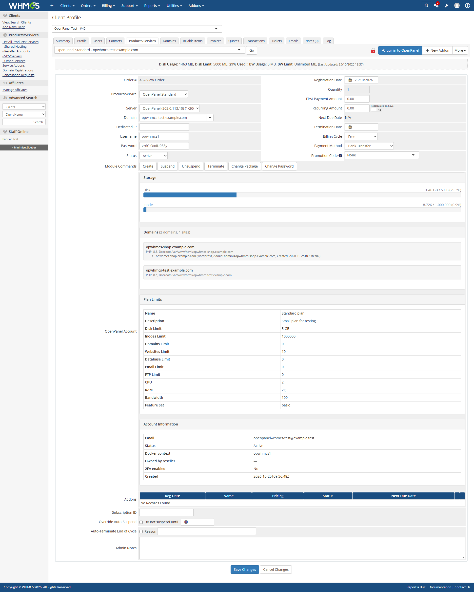

# OpenPanel WHMCS Module for WHMCS 9

Provisioning module for [OpenPanel](https://openpanel.com), rewritten for WHMCS 9.x.
It is based on the v1 module in the root of this repository.



## Requirements

- WHMCS 9.0 or later, on PHP 8.2 or 8.3
- An OpenPanel Enterprise server with the OpenAdmin API enabled
- From the WHMCS server, access to OpenAdmin's port (2087 by default)

## Installation

1. On the WHMCS server, download the repository and copy this `WHMCS-9` folder into WHMCS as `modules/servers/openpanel`:
   ```bash
   git clone https://github.com/stefanpejcic/openpanel-whmcs-module.git ~/openpanel-whmcs-module
   cp -r ~/openpanel-whmcs-module/WHMCS-9 path_to_whmcs/modules/servers/openpanel
   ```
   The folder must be named `openpanel`, because every function is prefixed with `openpanel_`.
2. In WHMCS go to **System Settings > Servers > Add New Server**, then:
   - **Module:** OpenPanel
   - **Hostname or IP:** the OpenAdmin hostname or IP. A hostname is always reached over `https://`. A bare IP is reached over `https://` when **Use SSL Mode for Connections** is ticked (the WHMCS default), and over plain `http://` when it is not. OpenAdmin serves HTTPS on its IP once Caddy has a certificate for it (Let's Encrypt issues IP certificates), so untick the box only if `https://<ip>:2087` doesn't load.
   - **Username / Password:** an OpenAdmin administrator
   - **Port:** 2087, unless you changed it
   - Click **Test Connection**.
3. Put the server in a server group. On each product, open **Module Settings**, pick that group, and choose the **OpenPanel Plan**. WHMCS loads the dropdown from the server.

```
modules/servers/openpanel/
├── openpanel.php                 module functions
├── lib/ApiClient.php             OpenAdmin API client (token cache, logging)
├── lib/ApiException.php
├── templates/clientarea.tpl      client area "Log in to OpenPanel" button
├── templates/admin_services_tab.php
└── whmcs.json
```

## Supported operations

| Where | What |
|---|---|
| Server page | Test Connection, and **Log in to OpenAdmin** (single sign-on as the server admin) |
| Product | Plan dropdown loaded from the server |
| Service, admin area | Create (user and domain), Suspend, Unsuspend, Terminate, Change Package, Change Password, **Log in to OpenPanel**, and an account panel showing storage, domains, sites, plan limits and status |
| Service, client area | **Log in to OpenPanel**, Change Password |
| Daily cron | Disk usage import into WHMCS (`diskusage`/`disklimit`, in MB) |

## Upgrading from v1

1. Move the old `path_to_whmcs/modules/servers/openpanel` folder out of `modules/servers` (keep it as a backup), then install this version as in step 1 of [Installation](#installation).
2. **Check each product's plan.** v1 showed a Plan dropdown but ignored it, and always used the OpenPanel plan named exactly like the WHMCS product. This version uses the dropdown:
   - If the field is empty, it falls back to the plan named after the product, as v1 did.
   - If the field holds a number (v1 saved plan IDs there), it is matched to the plan with that ID.
   - To be safe, open each OpenPanel product, pick the plan and save.
3. The per-page-load login links (`LoginLink`, `AdminLink`) are replaced by WHMCS's single sign-on buttons. Login links are now created only when someone clicks.
4. The `OPENPANEL_DEBUG` constant is gone. Use the WHMCS module log instead (below). Passwords and tokens are masked in it.

## Updating

```bash
cd ~/openpanel-whmcs-module && git pull
cp -r WHMCS-9/. path_to_whmcs/modules/servers/openpanel/
```

## Troubleshooting

In WHMCS:

1. Turn on [module logging](https://developers.whmcs.com/provisioning-modules/module-logging/).
2. Repeat the action.
3. Check `YOUR_WHMCS_ADMIN_URI/index.php?rp=/admin/logs/module-log`. Each OpenAdmin request is logged with its HTTP status.

Failed client-area logins are written to the WHMCS activity log. The client only sees a generic message.

On the OpenPanel server, enable [`DEV_MODE`](https://dev.openpanel.com/cli/config.html#dev-mode) and read `/var/log/openpanel/admin/api.log`.

Common errors:

- **OpenAdmin is rate-limiting logins.** OpenAdmin allows 5 logins per IP, then `login_ratelimit` per minute (default 5), and the OpenAdmin login form shares that limit. This module reuses one token for up to 10 minutes, so you should only see this if something else is logging in from the WHMCS server's IP.
- **HTTP 500 with no message.** OpenAdmin does not pass `opencli` error output back through the API. Run the same `opencli` command on the server to see the reason.
